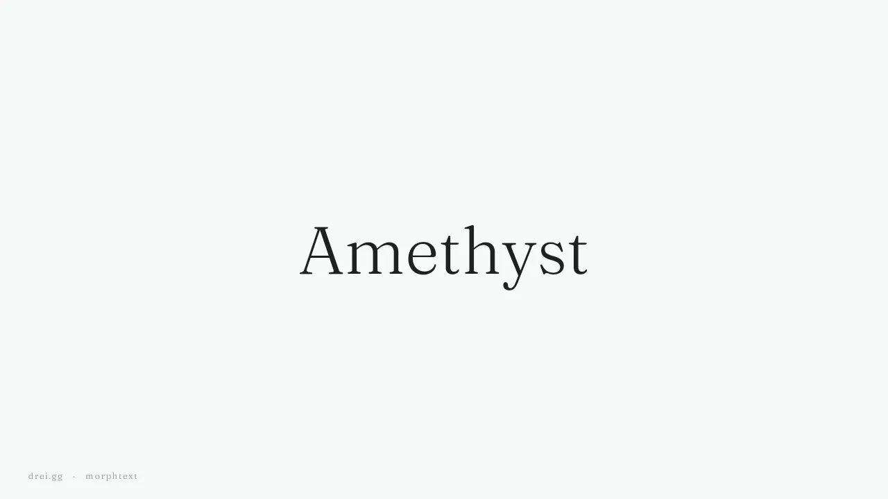

# morphtext

**Text that morphs between two styles letter by letter, outline into outline.**

A light word turns bold, a small word grows, and it stays one word the whole
way: no crossfade between two copies, no ghosted double name in the middle.
Each letter's real outline in each style is read from your bundled font and
morphed into the other, and at either end it is plain text, pixel for pixel
what a `Text` draws.



morphtext is a companion to [morphnext](https://github.com/KickNext/morphnext)
by KickNext, which morphs icon glyphs read from icon fonts. morphnext is the
engine here: its OpenType reader decodes each letter's outline and its
topology-aware planner pairs the contours of the light letter with those of
the bold one. morphtext adds the text layer on top: laying the word out in
both styles, placing every letter's em square between its two layouts, and
handing back to plain text at the ends.

## Why

Most fonts ship a few static weights, not a variable axis. Animating
`fontWeight` between two of them can only crossfade (or snap), and a
crossfade between `Amethyst` light and `Amethyst` bold reads as two names
stacked on each other. Morphing each letter's outline gives the in-between
weights the font never shipped.

## Install

> Draft: not on pub.dev yet.

```yaml
dependencies:
  morphtext: ^0.1.0
```

Requires Dart `>=3.9.0` and Flutter `>=3.32.0`.

Bundle the font in **both** styles in `pubspec.yaml`, as you would for `Text`.
morphtext reads the outlines from those files:

```yaml
flutter:
  fonts:
    - family: Fraunces
      fonts:
        - asset: fonts/Fraunces-300-normal.ttf
          weight: 300
        - asset: fonts/Fraunces-600-normal.ttf
          weight: 600
```

## Implicit morph

Change `style`; `AnimatedMorphText` springs from the style on screen to the
new one. Turning back mid-flight reverses from where the word is.

```dart
import 'package:morphtext/morphtext.dart';

const light = TextStyle(
  fontFamily: 'Fraunces',
  fontWeight: FontWeight.w300,
  fontSize: 52,
);

GestureDetector(
  onTap: () => setState(() => selected = !selected),
  child: AnimatedMorphText(
    'Amethyst',
    style: selected ? light.copyWith(fontWeight: FontWeight.w600) : light,
  ),
)
```

It uses morphnext's `MorphSprings.snappy` by default; pass `MorphSprings.smooth`
or any `SpringDescription` as `spring`. `onEnd` fires when a transition
settles. With `MediaQuery.disableAnimations`, style changes apply at once.

## Controlled morph

Drive `t` yourself (a page position, a scroll offset, a gesture, an
`AnimationController` in an `AnimatedBuilder`). It is clamped to 0–1.

```dart
MorphText(
  'Rose Quartz',
  from: light.copyWith(fontSize: 22),
  to: light.copyWith(fontSize: 48),
  t: progress,
)
```

Size, colour and weight come along, and upright to italic if both faces are
bundled (letters whose italic is a different design, like a single-storey
`a`, morph less gracefully than weights do). Both styles are merged onto the
ambient `DefaultTextStyle`, like `Text`.

Fonts from a package are named the Flutter way:
`TextStyle(fontFamily: 'Fraunces', package: 'my_fonts')`. Don't write the
`packages/my_fonts/Fraunces` string yourself: merging with the default style
would prefix it twice.

## How it works

1. Flutter lays the word out in both styles with `TextPainter`: each letter's
   pen position, kerning and baseline.
2. For each style, the font file is found through `FontManifest.json` (the
   family's nearest declared weight, upright or italic as asked) and parsed
   once by morphnext's OpenType reader. Each letter's outline is sampled into
   contours.
3. morphnext plans each letter's morph, pairing contours (the bowl of the
   light `a` with the bowl of the bold one, its counter with its counter).
4. Each frame, every letter's outline is interpolated to `t` and drawn into
   its em square, carried from the first layout to the second.
5. At `t = 0` and `t = 1` it draws the word with `TextPainter` instead, so
   resting text is real text: hinting, antialiasing and all.

Fonts, plans and layouts are cached: a font is parsed once per asset bundle,
and letter plans are shared by every `MorphText` on the bundle.

## Limitations

- **The outlines must be readable from the bundled font file.** TrueType
  (`glyf`) and CFF outlines in `.ttf`/`.otf`, declared in `pubspec.yaml`.
  Fonts loaded at runtime (`FontLoader`, google_fonts downloads) or system
  fonts aren't in `FontManifest.json`. Then `MorphText` draws plain text and
  switches style at the middle (a debug build says why, once).
- **Plain-text ends.** Only `t` strictly between 0 and 1 draws outlines. The
  outline is filled geometry, without hinting, so on small low-DPI text the
  first frame of a morph can look a hair softer than the text at rest.
- **One line, one direction, no shaping.** Letters morph code point by code
  point at the positions Flutter laid out, so scripts that shape glyphs
  contextually (Arabic, Indic) and ligatures don't morph faithfully. If your
  font has ligatures in the word (`fi`, `ffl`), turn them off in both styles
  with `fontFeatures: [FontFeature.disable('liga')]`.
- **Letters missing from the font** (fallback glyphs, emoji) are drawn as
  text at their moving position, in the nearer style, rather than morphed.
- **Static weights morph; variable axes don't yet.** Two static faces are
  read as two outlines. A single variable font is read at its default
  instance (see *Ideas* below).
- **Text changes don't morph.** `AnimatedMorphText` morphs style changes; a
  new string appears in place. A third style arriving mid-flight starts from
  whichever of the two the word is nearer.
- **Semantics.** The word is painted, not laid out as a `Text`, so it is
  exposed as one semantics node labelled with the text (override with
  `semanticsLabel`). It isn't selectable.

## Ideas

- Variable fonts: read each style's `wght` from `fontVariations` and morph
  between two instances of one file (morphnext's reader already supports the
  axes).
- Word to word: pair letters of two different strings, as morphnext pairs two
  icons.
- Interrupting with a third style from the in-between shape, as
  `AnimatedMorphIcon` does.

## Example

`example/` is a small app: tap a word to make it bold, slide to grow another.

The hero above follows the shape of morphnext's own, so the two read as a
pair. It is rendered frame by frame in a widget test
(`tool/record_demo_test.dart`, 1280x720 at 60 fps) and encoded by
`tool/record_demo.sh`.

## License and attribution

morphtext is MIT licensed.

It is built on [morphnext](https://github.com/KickNext/morphnext) (MIT,
© 2026 KickNext), whose outline reader and morph planner do the heavy
lifting; morphnext in turn adapts MIT-licensed work from Morphicons and
icon_font_generator (see its `THIRD_PARTY_NOTICES.md`). morphtext is an
independent project, not affiliated with or endorsed by KickNext.

The example and tests bundle Fraunces (© 2020 The Fraunces Project Authors,
SIL Open Font License 1.1).
