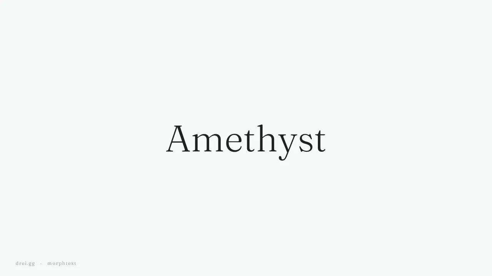

Numina has a moment where a stone's name flies from the light title on Today to the bold title on its card. The font ships two weights, light and semibold, and nothing in between. Every crossfade we tried read as two names stacked on each other: *Amethyst* and **Amethyst**, ghosting.

So the name doesn't crossfade any more. Each letter's real outline is read from the font file in both weights, and the light *A* turns into the bold one, contour into contour. At either end it's plain text, pixel for pixel what Flutter's `Text` draws. In the middle it's the weights the font never shipped.

Once letters are outlines, the font doesn't have to be the same font. A serif *Amethyst* melts into a sans one, serifs and all. And the word doesn't have to be the same word: *Amethyst* becomes *Citrine*, each letter turning into the one at its place, the leftovers shrinking away.



## Standing on morphnext

[morphnext](https://github.com/KickNext/morphnext) by KickNext morphs icons: it reads glyphs out of icon fonts and pairs their contours so a menu turns into a close button without anyone drawing the in-between. Letters are glyphs too. Its docs never mention text, and its widgets use one font weight for both ends, but the engine underneath doesn't care.

morphtext is the text layer on top. Flutter lays the word out in both styles (pen positions, kerning, baseline); morphnext reads each letter's outline and plans the morph; morphtext carries every letter's em square from one layout to the other and hands back to real text at the ends.

```dart
AnimatedMorphText(
  stones[i],                 // a new word morphs from the old one
  style: loud ? sans : serif, // so does a new font
)
```

Or drive it yourself with `MorphText(text, toText:, from:, to:, t:)`.

```pull
Letters are glyphs too.
-- anya
```

```notes
+ MorphText: text between any two styles, driven by t
+ Font to font: serif into sans, any two bundled faces
+ Word to word: each letter becomes its counterpart, leftovers shrink away
+ AnimatedMorphText: springs to each new word and style, reverses mid-flight
+ Plain text at both ends, at the same size and place as Text
~ Fonts must be bundled: the outlines come from the files
! Ligatures and contextual scripts don't morph faithfully (yet)
```

## Where it's at

It's MIT, it lives at [morphtext.drei.gg](https://morphtext.drei.gg) (a playground you can type into) and [github.com/drei-gg/morphtext](https://github.com/drei-gg/morphtext), and it's on pub.dev as `morphtext`. It works on morphnext's internals for now; we've asked upstream for a small public API so it can depend on morphnext properly.

```callout
Draft
Written by Anya for Drei to rewrite in his voice. Links, the repo path, the pub.dev line and the upstream sentence are placeholders until each of those steps happens.
```
